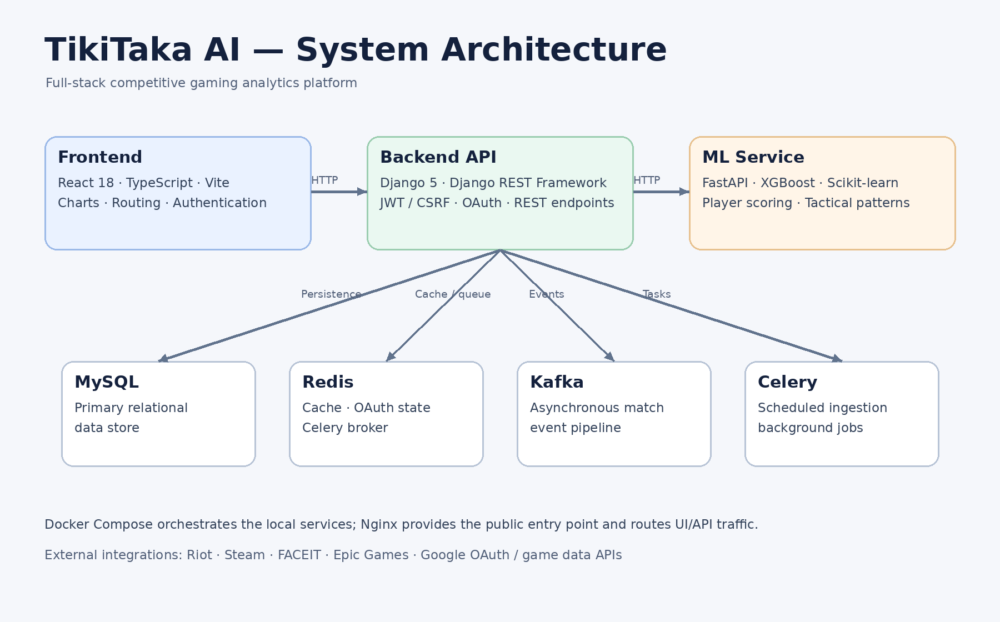

# TikiTaka AI — Competitive Gaming Analytics

TikiTaka AI is a full-stack platform for competitive gaming analytics. It connects player game accounts, ingests match data from supported provider APIs, processes match events, and exposes player-performance scores and tactical-pattern insights through a web application.



## Core capabilities

- **User accounts and authentication:** Django REST API with JWT/CSRF support and OAuth integrations.
- **Game-account linking:** provider integrations for Riot, Steam, FACEIT, Epic Games, and Google sign-in.
- **Match-data ingestion:** scheduled and user-triggered ingestion workflows.
- **Event processing:** Kafka-based asynchronous match-event pipeline, with Celery background tasks.
- **Player analytics:** FastAPI service for player scoring and tactical-pattern detection.
- **Interactive dashboard:** React and TypeScript frontend with charts and application routing.
- **Containerized development:** Docker Compose orchestration for the application and supporting infrastructure.

## Architecture

| Component | Technology | Responsibility |
|---|---|---|
| Frontend | React 18, TypeScript, Vite | Web application and analytics UI |
| Backend | Django 5, Django REST Framework | Authentication, accounts, games, matches, ingestion APIs |
| ML service | FastAPI, XGBoost, scikit-learn | Player scoring and tactical-pattern analysis |
| Database | MySQL 8 | Persistent application data |
| Cache / broker | Redis | Cache, OAuth state, Celery broker |
| Event streaming | Kafka + ZooKeeper | Asynchronous match-event pipeline |
| Background jobs | Celery, django-celery-beat | Scheduled ingestion and background processing |
| Reverse proxy | Nginx | Routes frontend and API traffic |

## Repository structure

```text
TikiTaka-AI-Gaming-Analytics/
├── backend/                 # Django REST API and background jobs
├── frontend/                # React + TypeScript + Vite application
├── ml-service/              # FastAPI analytics and scoring service
├── deploy/
│   ├── cloudrun/            # Cloud Run deployment resources
│   └── render/              # Render deployment guide and environment template
├── nginx/                   # Reverse-proxy configuration
├── images/
│   └── system-architecture.png
├── docker-compose.yml
├── .env.example
└── README.md
```

## Run locally with Docker Compose

### Prerequisites

- Docker Desktop with Docker Compose
- Git
- API/OAuth credentials only for integrations you want to enable

### Setup

1. Clone the repository and enter its directory:

   ```bash
   git clone <YOUR_GITHUB_REPOSITORY_URL>
   cd TikiTaka-AI-Gaming-Analytics
   ```

2. Create your local environment file:

   ```bash
   cp .env.example .env
   ```

3. Edit `.env` and provide secure local values. At minimum, generate a strong `JWT_SECRET` and an `OAUTH_TOKEN_ENCRYPTION_KEY`:

   ```bash
   openssl rand -base64 32
   ```

   Use separate generated values for the JWT signing secret and OAuth token encryption key. Add provider credentials only for the integrations you configure. Never commit `.env`.

4. Build and start the services:

   ```bash
   docker compose up --build
   ```

### Local endpoints

| Service | URL |
|---|---|
| Application through Nginx | http://localhost |
| Frontend container | http://localhost:3000 |
| Django API | http://localhost:8080/api/v1 |
| ML service | http://localhost:8000 |
| Backend health endpoint | http://localhost:8080/actuator/health |

The MySQL container is exposed on host port `3307`.

## Development without Docker

### Backend

```bash
cd backend
python -m venv .venv
source .venv/bin/activate        # Windows: .venv\Scripts\activate
pip install -r requirements.txt
python manage.py migrate
python manage.py runserver 8080
```

The backend also depends on infrastructure services such as MySQL, Redis, and Kafka. Configure the corresponding environment variables before starting it.

### Frontend

```bash
cd frontend
npm install
npm run dev
```

Use the frontend's configured API/proxy settings to point to the backend.

### ML service

```bash
cd ml-service
python -m venv .venv
source .venv/bin/activate        # Windows: .venv\Scripts\activate
pip install -r requirements.txt
uvicorn main:app --reload --host 0.0.0.0 --port 8000
```

## Configuration and integrations

Copy `.env.example` to `.env` and configure only the services you intend to use. The project includes environment settings for:

- JWT signing and OAuth token encryption
- Google, Riot, Steam, FACEIT, and Epic OAuth
- Riot and FACEIT game-data API access
- SMTP-based password-reset delivery
- Database, Redis, Kafka, and deployment configuration

Provider credentials and production secrets must be stored in deployment environment settings, not in source control.

## Deployment

Deployment resources and notes are included under:

- `deploy/render/`
- `deploy/cloudrun/`

Review the corresponding deployment guide and configure external database, Redis, OAuth redirect URLs, allowed origins, and production secrets before deploying.

## Testing

The ML service includes API, tactical-pattern, and player-scoring tests under `ml-service/tests/`. From the ML service directory, install its requirements and run:

```bash
pytest
```

## Security notes

- Do not commit `.env`, API keys, OAuth client secrets, database passwords, JWT secrets, or encryption keys.
- Generate unique secrets for each environment.
- Configure production HTTPS, secure cookies, CORS, allowed hosts, and OAuth callback URLs for your deployed domain.
- The credentials in Docker Compose are local-development defaults only; replace them before using any shared or production environment.

## License

No license file was present in the supplied project archive. Add an appropriate license before presenting the repository as open source.

## Author

**Adarsh Pratap Singh**
